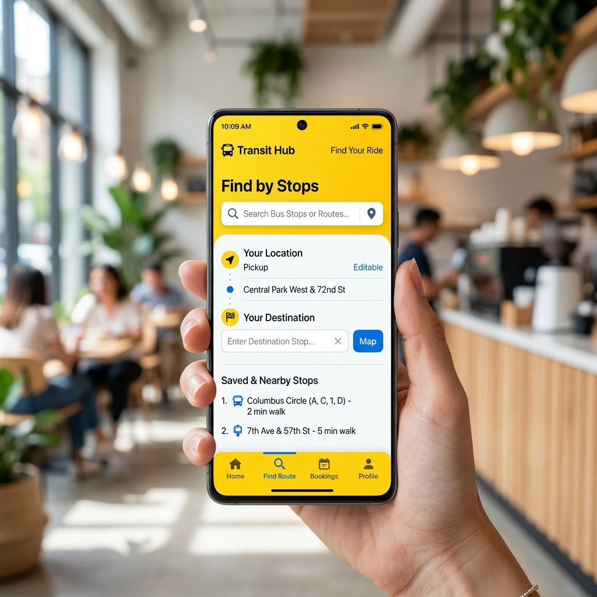
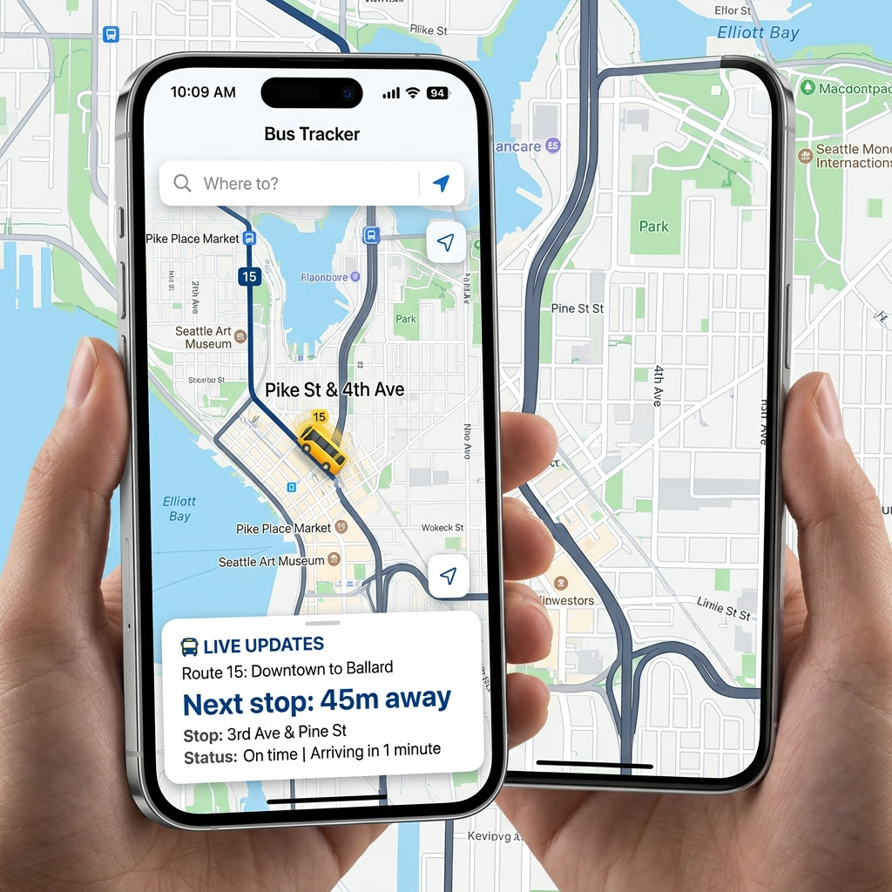
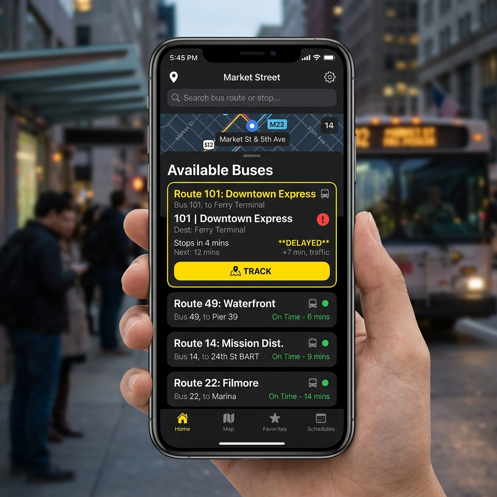
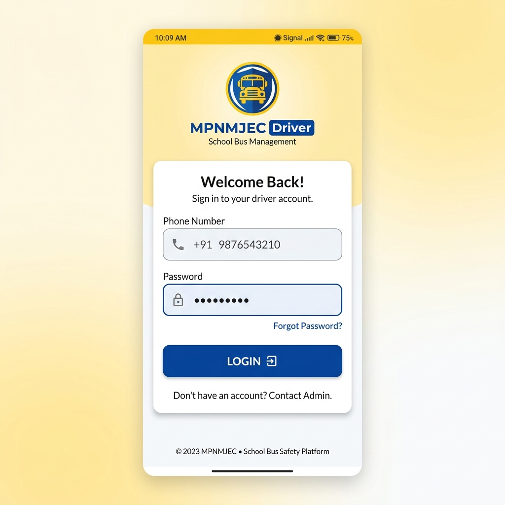
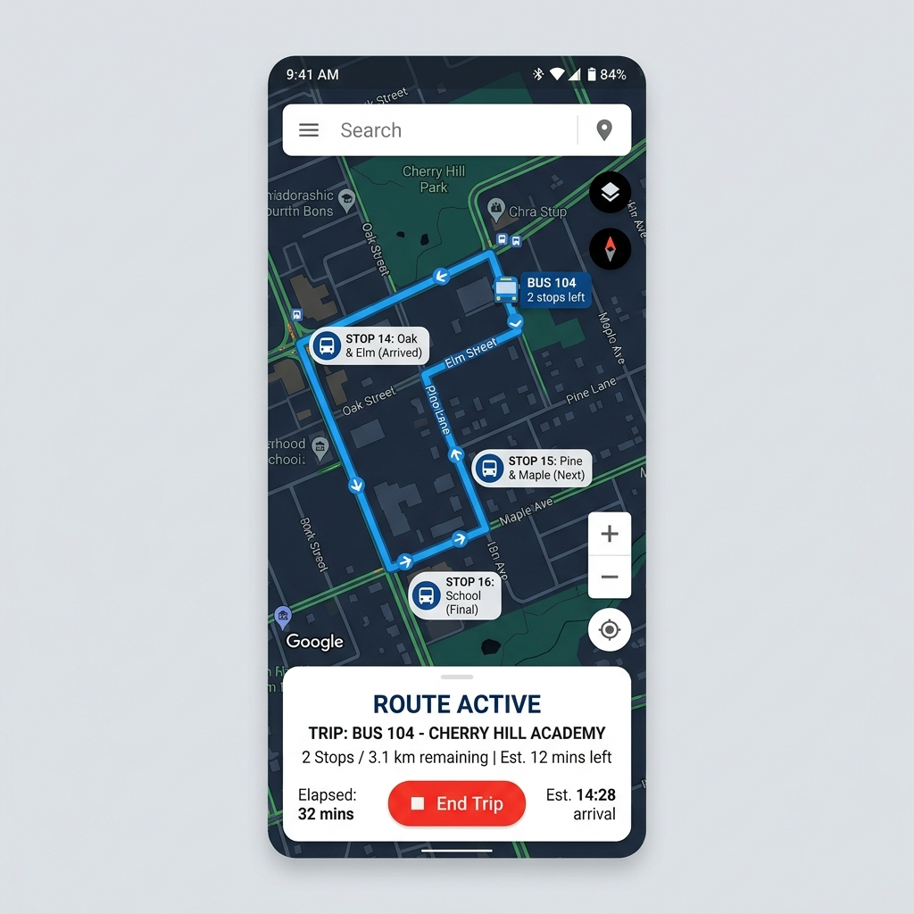
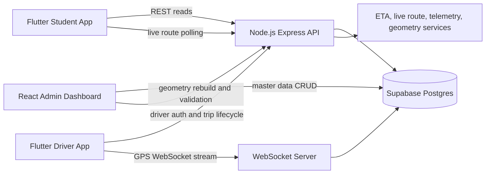

# MPNMJEC Bus Tracking System

A complete college transport tracking platform for MPNMJEC. The system connects a Flutter student app, a Flutter driver app, a React admin dashboard, and a Node.js tracking backend so students can see active college buses in real time while the transport team manages fleet, routes, stops, schedules, and trips.

## Live Links

| Resource | Link |
| --- | --- |
| Backend deployment | https://mpnmjec-backend.onrender.com |
| Backend health check | https://mpnmjec-backend.onrender.com/health |
| REST API root | https://mpnmjec-backend.onrender.com/api |
| WebSocket endpoint | wss://mpnmjec-backend.onrender.com/ws |
| Student app on Play Store | https://play.google.com/store/apps/details?id=com.sixmindslabs.mpnmjecbustracker.student |
| Backend privacy policy | https://mpnmjec-backend.onrender.com/privacy |

The backend runs on Render and may need a short cold-start wakeup on the free tier. The admin web app has deployment configs for Render and Vercel in `render.yaml` and `admin/vercel.json`; add the public admin URL here once that static site is hosted.

## Screenshots

### Student App

| Search and route selection | Available buses | Live tracking |
| --- | --- | --- |
|  |  |  |

### Driver App

| Driver login | Trip tracking |
| --- | --- |
|  |  |

## Features

### Student App

- Search pickup and destination stops.
- View active buses for matching routes.
- Track live bus movement on a map.
- See route progress, upcoming stops, ETA, and delay status.
- Use local stop-arrival alarm preferences.
- Connects to the live backend by default and supports build-time backend overrides.

### Driver App

- Driver login with credentials managed by the transport admin.
- View assigned route, bus, schedule, and trip direction.
- Start, pause, resume, complete, or cancel active trips.
- Stream GPS telemetry to the backend over WebSocket.
- Buffer GPS points during short network outages and flush them when online.
- Continue active-trip tracking with an Android foreground service.

### Admin Dashboard

- Manage drivers, buses, routes, stops, and daily schedules.
- Configure outbound and return route legs.
- Validate driver and bus assignment conflicts.
- Rebuild route geometry after route or stop changes.
- Uses Supabase for master data and the tracking backend for operational actions.

### Backend

- Express REST API for public route data, driver auth, trip lifecycle, active trips, and live-route snapshots.
- WebSocket GPS ingestion for authenticated driver trips.
- Supabase persistence for drivers, buses, routes, stops, schedules, trips, and telemetry.
- ETA, next-stop, delay-status, online/offline, and route-geometry services.
- Render-ready production configuration.

## Architecture Overview



### Repository Layout

| Path | Purpose |
| --- | --- |
| `backend/` | Node.js, Express, WebSocket, Supabase service-role access, live tracking logic |
| `admin/` | React, Vite, Tailwind admin dashboard for transport configuration |
| `student_app/` | Flutter student-facing bus tracker |
| `driver_app/` | Flutter driver-facing trip and GPS tracker |
| `scripts/start-local.ps1` | Convenience script to boot backend and admin locally on Windows |
| `render.yaml` | Render blueprint for backend and admin static deployment |
| `admin/supabase_schema.sql` | Base Supabase tables for the transport domain |
| `backend/sql/` | Incremental SQL migrations for trip guards, geometry, and return-leg support |

### Data Model

The main Supabase tables are:

- `drivers` - authorized transport drivers and login credentials.
- `buses` - fleet records, capacity, status, and identifiers.
- `routes` - route metadata and generated geometry.
- `stops` - ordered stops with coordinates, arrival times, and trip direction.
- `schedules` - driver, bus, route, outbound, and return assignments.
- `trips` - active and historical trip sessions.
- `telemetry` - GPS points received from active driver trips.

## Tech Stack

| Layer | Technology |
| --- | --- |
| Student app | Flutter, Dart, `flutter_map`, `web_socket_channel`, `http`, `audioplayers`, `shared_preferences` |
| Driver app | Flutter, Dart, `geolocator`, `permission_handler`, `flutter_foreground_task`, `web_socket_channel`, `flutter_secure_storage` |
| Admin dashboard | React 19, Vite 8, Tailwind CSS 4, Supabase JS, React Hook Form, Zustand, Leaflet, Lucide React |
| Backend | Node.js, Express, WebSocket `ws`, Supabase JS, JWT, CORS, dotenv |
| Database | Supabase Postgres |
| Maps | Leaflet and Flutter Map with OpenStreetMap tiles |
| Deployment | Render for backend, Render or Vercel for admin static hosting, Google Play for Android distribution |

## Setup Instructions

### Prerequisites

- Node.js `20.19+` or `22.12+`.
- npm.
- Flutter `3.10+` with Dart `3.x`.
- Android Studio or a configured Android emulator for mobile testing.
- A Supabase project with the schema from `admin/supabase_schema.sql` and migrations from `backend/sql/`.

### Environment Variables

Create `backend/.env` from `backend/.env.example`:

```env
NODE_ENV=development
PORT=3001
ALLOWED_ORIGINS=http://localhost:5173,http://127.0.0.1:5173
JWT_SECRET=local-dev-secret-change-me
SUPABASE_URL=https://your-project.supabase.co
SUPABASE_SERVICE_ROLE_KEY=your-service-role-key
APP_TIMEZONE=Asia/Kolkata
BUS_OFFLINE_THRESHOLD_SECONDS=300
TRIP_DELAY_THRESHOLD_MINUTES=5
MIN_ETA_SPEED_KMH=18
STOP_ARRIVAL_RADIUS_METERS=80
```

Create `admin/.env.local` from `admin/.env.example`:

```env
VITE_SUPABASE_URL=https://your-project.supabase.co
VITE_SUPABASE_ANON_KEY=your-anon-key
VITE_TRACKING_BACKEND_URL=http://localhost:3001
```

The Flutter apps use `https://mpnmjec-backend.onrender.com/` by default. Override the backend at run time with Dart defines when testing locally.

## Run Locally

### Backend and Admin Together

From the repository root:

```powershell
powershell -ExecutionPolicy Bypass -File .\scripts\start-local.ps1
```

This starts:

- Backend: http://localhost:3001
- Backend health: http://localhost:3001/health
- Admin dashboard: http://localhost:5173

The script creates placeholder local env files if they do not exist. Replace the placeholder Supabase values for real database-backed data. The generated `admin/.env.local` points at the Render backend by default; set `VITE_TRACKING_BACKEND_URL=http://localhost:3001` when you want the admin dashboard to use your local backend.

### Manual Backend Setup

```powershell
cd backend
npm ci
npm run dev
```

### Manual Admin Setup

```powershell
cd admin
npm ci
npm run dev
```

### Student App

Run against the production backend:

```powershell
cd student_app
flutter pub get
flutter run -d chrome
```

Run against a local backend from Chrome:

```powershell
cd student_app
flutter run -d chrome --dart-define=TRACKING_BACKEND_URL=http://localhost:3001
```

Run against a local backend from an Android emulator:

```powershell
cd student_app
flutter run --dart-define=TRACKING_BACKEND_URL=http://10.0.2.2:3001
```

### Driver App

Run against the production backend:

```powershell
cd driver_app
flutter pub get
flutter run
```

Run against a local backend from an Android emulator:

```powershell
cd driver_app
flutter run --dart-define=TRACKING_BACKEND_URL=http://10.0.2.2:3001
```

For a physical Android device, replace `10.0.2.2` with the computer's LAN IP address and keep the phone on the same network.

## Build Commands

### Admin Production Build

```powershell
cd admin
npm run build
```

### Backend Production Start

```powershell
cd backend
npm start
```

### Student Android Build

```powershell
cd student_app
flutter build apk --release
```

### Driver Android Build

```powershell
cd driver_app
flutter build apk --release
```

## API Summary

| Method | Endpoint | Purpose |
| --- | --- | --- |
| `POST` | `/api/auth/login` | Driver login |
| `GET` | `/api/drivers/me` | Authenticated driver profile |
| `GET` | `/api/drivers/me/assignment` | Current driver assignment |
| `GET` | `/api/routes` | Public route list |
| `GET` | `/api/stops` | Public stop list, optionally filtered by route |
| `GET` | `/api/buses` | Active buses |
| `GET` | `/api/schedules` | Schedules, optionally filtered by driver or route |
| `POST` | `/api/schedules/validate-assignment` | Validate driver and bus conflicts |
| `POST` | `/api/trips` | Start a driver trip |
| `GET` | `/api/trips/active` | Active trips for student/admin views |
| `GET` | `/api/trips/:id/live-route` | Live route, ETA, and progress snapshot |
| `PATCH` | `/api/trips/:id/status` | Update trip status |
| `POST` | `/api/auth/ws-token` | Create driver WebSocket auth token |

WebSocket GPS ingestion is available at `/ws`. Driver clients authenticate with an `AUTH` message, then send `GPS`, `BATCH`, `STATUS`, and `PING` messages.

## Deployment

### Backend on Render

The backend is already configured by `render.yaml`:

- Root directory: `backend`
- Build command: `npm install`
- Start command: `node index.js`
- Required secrets: `SUPABASE_URL`, `SUPABASE_SERVICE_ROLE_KEY`, `JWT_SECRET`
- Production URL: https://mpnmjec-backend.onrender.com

### Admin Static Hosting

The admin can be hosted through the root `render.yaml` static service or through Vercel using `admin/vercel.json`. Required variables:

```env
VITE_SUPABASE_URL=https://your-project.supabase.co
VITE_SUPABASE_ANON_KEY=your-anon-key
VITE_TRACKING_BACKEND_URL=https://mpnmjec-backend.onrender.com/
```

### Android Distribution

The published student app is available on Google Play:

https://play.google.com/store/apps/details?id=com.sixmindslabs.mpnmjecbustracker.student

Play Store listing assets are stored in:

- `student_app/play_store_assets/`
- `driver_app/play_store_assets/`

## Notes

- Student devices do not submit student location data in the current build.
- Driver location is collected for official active trips so students and admins can track college buses.
- Keep Supabase service-role keys only on the backend. Do not expose service-role credentials in Flutter or admin frontend builds.
- Local placeholder env files are useful for booting the apps, but real transport data requires valid Supabase credentials.
